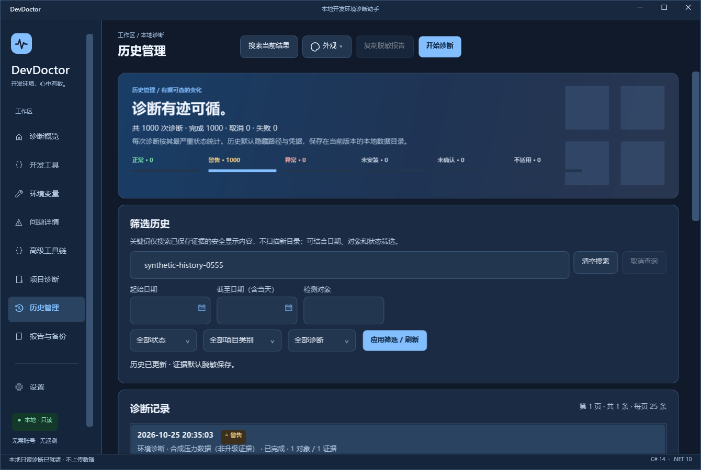

[English](README.md) · [简体中文](README.zh-CN.md)

# DevDoctor

DevDoctor is a local diagnostic tool for developer environments on Windows 11 x64. It compares tool versions, environment variables, PATH order, and project configuration to help identify version conflicts, missing toolchains, and mismatches between a project's requirements and the local environment.

The screenshot shows DevDoctor's WPF history view. Both the search query and the records were generated by the test harness.

## Features

- Check Java, Python, pip, Node.js, npm, Git, Maven, Gradle, the .NET SDK, CMake, and Visual Studio/MSVC. Results include the evidence behind confirmed findings, potential risks, and findings that could not be verified.
- Scan the Maven, Gradle, Node.js, Python, CMake, and .NET configuration in a selected directory in read-only mode. See what each project requires and whether the local environment meets those requirements.
- Search issues, projects, and saved evidence. Press **Ctrl+K** to search the current results. Open a finding for manual troubleshooting guidance or rerun the relevant checks.
- Keep diagnostic history in a local SQLite database. Filter and compare records, export JSON, HTML, or Markdown reports, and create or restore full backups.
- Choose from six themes and three interface styles. Use light, dark, or Windows appearance settings and adjust app scaling. The current application interface and installer wizard are primarily in Simplified Chinese.

Version **1.2.0** uses C# 14, .NET 10, WPF, MVVM, Microsoft.Data.Sqlite, xUnit, and Inno Setup. [Release notes (Simplified Chinese)](docs/RELEASE-NOTES-v1.2.0.md)

## Installing and running

Only the v1.2.0 source code is published on GitHub. Installer and portable downloads are currently unavailable. You can build both locally using the packaging guide below.

- **Installer.** Run the locally built `DevDoctor-v1.2.0-win-x64-Setup.exe` and choose an install location in the Simplified Chinese wizard. It installs for the current Windows user and defaults to `%LOCALAPPDATA%\Programs\DevDoctor`. Locally built installers are unsigned by default. Windows determines whether to display a publisher warning based on system policy.
- **Portable build.** Extract the full `DevDoctor-v1.2.0-win-x64-portable.zip` archive. Keep the package directory and `portable.mode` intact, then run `DevDoctor.exe`. The self-contained package includes the runtime.
- **Development.** Start DevDoctor from the repository using [scripts/run.ps1](scripts/run.ps1) or the .NET SDK command below.

## Development and verification

Run these commands from the repository root in PowerShell 7 on Windows 11 x64 with the .NET 10 SDK. SDK 10.0.402 was used to verify the v1.2.0 source release. `global.json` specifies the SDK baseline and roll-forward policy, and `NuGet.Config` points to NuGet.org.

~~~powershell
dotnet restore .\DevDoctor.slnx --configfile .\NuGet.Config
dotnet build .\DevDoctor.slnx -c Release --no-restore
dotnet test .\tests\DevDoctor.Tests\DevDoctor.Tests.csproj -c Release --no-build --no-restore
dotnet run --project .\src\DevDoctor.App\DevDoctor.App.csproj -c Release
~~~

`DevDoctor.slnx` is the repository's solution file. The local packaging workflow produces self-contained builds and uses Inno Setup 6.7.3. See the [build and packaging guide (Simplified Chinese)](docs/BUILD.md) for tool versions and verification steps.

## Data and privacy

| Data | Default location |
| --- | --- |
| Installed edition data | `%LOCALAPPDATA%\DevDoctor\Installed` |
| Portable edition data | `%LOCALAPPDATA%\DevDoctor\Portable\<app-directory-hash>` |
| Settings, history, and scope identity | `settings.json`, `history.sqlite3`, and `scope.key` in the edition's data directory |
| Recovery snapshots and interrupted restore state | `recovery/` and `restore.pending.json` in the data directory |
| Exported reports and full backups | The location you select in the file dialog |

DevDoctor reads the local development environment and saves selected diagnostic evidence in its local data directory. DevDoctor 1.2.0 does not implement telemetry, automatic uploads, or AI service calls. Diagnostics and manual troubleshooting guidance are available locally. Project detection runs probes using locally installed tools. What those tools do depends on the executables and system settings.

History, search, and exports use rule-based redaction. JSON, HTML, and Markdown reports may still include tool versions, diagnostic timestamps, scope identifiers, or recognizable raw output. Review reports before sharing them. A full backup is a regular ZIP archive that contains the local scope key, settings, and history. Treat it as private data. Uninstalling DevDoctor preserves application data. See the [security policy](SECURITY.md) to report a vulnerability.

## Known limitations

Static diagnostics can explain the project configuration they observe. Dynamic build scripts, conditional imports, and unknown tool versions may lead to unconfirmed findings. The application provides manual troubleshooting steps and commands you can copy. Verify window placement across monitors, unusual DPI settings, and nonstandard tool managers in the target environment.

DevDoctor's own code is released under the MIT License. Third-party components retain their own licenses. Separate redistribution terms apply to self-contained Windows binaries. [MIT License](LICENSE) · [Third-party notices](THIRD-PARTY-NOTICES.md)
