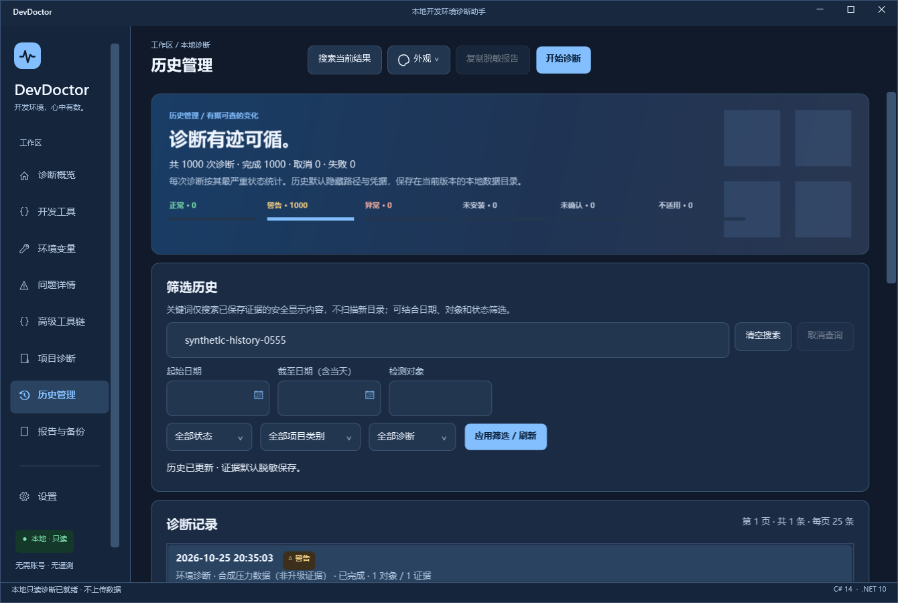

[English](README.md) · [简体中文](README.zh-CN.md)

# DevDoctor

DevDoctor 是面向 Windows 11 x64 的本地开发环境诊断助手。它结合工具版本、环境变量、PATH 顺序和项目配置，帮助定位多版本冲突、缺少工具链和项目要求不匹配等问题。

截图来自 DevDoctor 的 WPF 历史界面。查询词和记录均由测试程序生成。

## 功能

- 检查 Java、Python、pip、Node.js、npm、Git、Maven、Gradle、.NET SDK、CMake 和 Visual Studio/MSVC。按证据展示已确认、风险和未确认的结果。
- 只读扫描选定目录的 Maven、Gradle、Node.js、Python、CMake 和 .NET 配置，列出项目要求及本机匹配情况。
- 按问题、项目和已保存证据搜索。使用 **Ctrl+K** 打开当前结果搜索，定位问题后查阅人工处理建议或重测关联模块。
- 本地 SQLite 保存诊断历史，支持筛选、对比、JSON / HTML / Markdown 报告、完整备份和恢复。
- 六套主题与三种界面风格，支持浅色、深色、跟随 Windows 和应用缩放。当前界面和安装向导以简体中文为主。

技术栈为 C# 14、.NET 10、WPF、MVVM、Microsoft.Data.Sqlite、xUnit 和 Inno Setup。软件版本为 **1.2.0**。 [版本说明](docs/RELEASE-NOTES-v1.2.0.md)

## 安装与运行

GitHub 上的 v1.2.0 仅发布源码，目前不提供安装包或便携版下载。两种包均可按下文的打包说明在本地生成。

- **安装版。** 打开本地生成的 `DevDoctor-v1.2.0-win-x64-Setup.exe`，按简体中文向导选择安装位置。使用当前 Windows 用户的权限，默认程序目录为 `%LOCALAPPDATA%\Programs\DevDoctor`。重建的本地安装包默认未签名，Windows 会按当前系统策略决定是否显示发布者提示。
- **便携版。** 完整解压本地生成的 `DevDoctor-v1.2.0-win-x64-portable.zip`，保留包目录和 `portable.mode`，再运行其中的 `DevDoctor.exe`。自包含包使用随包运行时。
- **开发时运行。** 可从项目目录用 [scripts/run.ps1](scripts/run.ps1) 或下面的 .NET SDK 命令启动。

## 开发与验证

需要 Windows 11 x64、.NET 10 SDK 和 PowerShell 7。请在仓库根目录运行以下命令。v1.2.0 源码发行使用 SDK 10.0.402 验证。`global.json` 指定 SDK 基线版本和向前选择策略，`NuGet.Config` 指向 NuGet.org。

~~~powershell
dotnet restore .\DevDoctor.slnx --configfile .\NuGet.Config
dotnet build .\DevDoctor.slnx -c Release --no-restore
dotnet test .\tests\DevDoctor.Tests\DevDoctor.Tests.csproj -c Release --no-build --no-restore
dotnet run --project .\src\DevDoctor.App\DevDoctor.App.csproj -c Release
~~~

`DevDoctor.slnx` 是仓库的解决方案入口。本地打包流程生成自包含包并使用 Inno Setup 6.7.3，工具版本和校验步骤见 [构建与打包](docs/BUILD.md)。

## 数据与隐私

| 内容 | 默认位置 |
| --- | --- |
| 安装版数据 | `%LOCALAPPDATA%\DevDoctor\Installed` |
| 便携版数据 | `%LOCALAPPDATA%\DevDoctor\Portable\<程序目录哈希>` |
| 设置、历史、范围标识 | 各自数据目录下的 `settings.json`、`history.sqlite3`、`scope.key` |
| 恢复快照和中断状态 | 数据目录下的 `recovery/` 与 `restore.pending.json` |
| 导出报告和完整备份 | 用户在文件对话框中选择的位置 |

应用读取本机开发环境，并把选定的诊断证据保存在本地数据目录。DevDoctor 1.2.0 没有实现遥测、自动上传或 AI 服务调用，诊断和人工处理建议在本机使用。项目识别时会调用本机工具探针，外部工具的行为取决于实际程序和系统设置。

历史、搜索和导出使用规则脱敏。JSON、HTML 或 Markdown 报告仍可能含工具版本、诊断时间、范围标识或有辨识度的原始输出，分享前请复核。完整备份包含本地范围密钥、设置和历史，是普通 ZIP，应按私有数据保管。卸载会保留应用数据。如需反馈漏洞，请使用 [安全反馈说明](SECURITY.md)。

## 已知限制

静态项目诊断能够解释观测到的配置，动态构建脚本、条件导入及未知工具版本可能只给出未确认结论。应用提供人工建议和可复制命令。跨屏位置、特殊 DPI 与非标准工具管理器仍应在目标环境复核。

DevDoctor 自有代码采用 MIT 许可证。第三方组件继续适用各自许可，自包含 Windows 二进制的分发条款另行适用。 [MIT 许可证](LICENSE) · [第三方声明](THIRD-PARTY-NOTICES.md)
